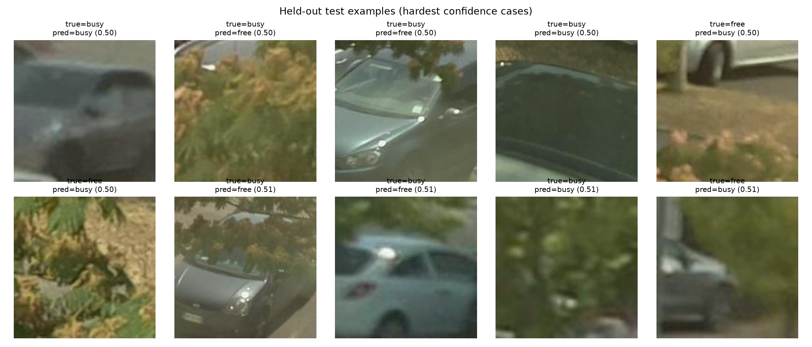

# Parking Space Occupancy Classification

**Course:** CSCI1409 Deep Learning, Bonus Project  
**Task:** classify one cropped parking space as `free` or `busy`  
**Dataset:** CNRPark (150×150 parking-space patches)  
**Model:** a compact CNN implemented in PyTorch  

> **Task-scope note:** The assignment handout asks for a fine-tuned pretrained object detector and mAP@0.50. The selected CNRPark-Patches dataset contains cropped parking-space images with image-level `free/busy` labels, but no bounding boxes. This repository therefore implements a CNN classifier trained from scratch. Precision, recall, F1 and average precision are reported; mAP@0.50 is not applicable. This is a related adaptation, not a complete match to the detection requirement; confirm with the instructor whether it is acceptable.

## Problem and approach

The prototype predicts whether a single, already identified parking-space crop is occupied. It does not locate spaces in a full parking-lot scene. A real deployment would also need a camera view and the coordinates of each parking space.

The network is a small CNN trained from random initialization. It has three convolutional blocks, adaptive average pooling, and a two-class output (`busy`, `free`). This model choice matches the dataset: each input already contains exactly one parking-space crop. Training used PyTorch 2.14.0, NumPy 2.4.3, Pillow 12.3.0, Matplotlib 3.11.1, and scikit-learn 1.8.0; seed 1409, image size 150, batch size 64, 12 epochs, Adam, and cross-entropy loss.

## Dataset

CNRPark-Patches-150x150 is part of the CNRPark parking-occupancy dataset. Images are stored as `camera/{free,busy}/YYYYMMDD_HHMM_SLOT.jpg`. The official page reports 12,584 CNRPark patches, collected by two cameras, with free/busy labels. The subset used here has:

| Camera | Busy | Free | Total |
|---|---:|---:|---:|
| A | 3,621 | 2,550 | 6,171 |
| B | 4,781 | 1,632 | 6,413 |
| **Total** | **8,402** | **4,182** | **12,584** |

### Experiment split counts

| Split | Busy | Free | Total | Camera/date |
|---|---:|---:|---:|---|
| Train | 2,891 | 1,954 | 4,845 | A / 2015-07-03 |
| Validation | 730 | 596 | 1,326 | A / 2015-07-03, held-out time groups |
| Test | 4,781 | 1,632 | 6,413 | B / 2015-07-08 |

Annotations are image-level class labels encoded by the parent directory (`free` or `busy`); no bounding-box annotation format is present.

Source/download: [official CNRPark page](https://cnrpark.it/). The page lists the small CNRPark patch archive at about 36.6 MB, describes the dataset, and states a CC BY 4.0 license. Cite: G. Amato et al., “Deep learning for decentralized parking lot occupancy detection,” *Expert Systems with Applications*, 2016.

### Split protocol

This downloaded subset contains only two date-camera pairs: 2015-07-03 from camera A and 2015-07-08 from camera B. The earlier day (camera A) is split into train and validation by 30-minute acquisition blocks; the later day (camera B) is held out for final testing. This prevents adjacent captures from the same 30-minute block from crossing train and validation. Because date and camera differ together, the final test measures a combined date/viewpoint shift; their effects cannot be separated with this subset. The split manifest and counts are written to `outputs/`.

## Reproduce in Google Colab

1. Download the `CNRPark-Patches-150x150.zip` archive from the official CNRPark page and put it in Google Drive or upload it when prompted in the notebook.
2. Open the notebook using the **Open in Colab** badge below. Select a GPU runtime if available.
3. Run the cells from top to bottom. The notebook installs pinned dependencies, extracts the archive, checks the classes, and runs both experiments.

[](https://colab.research.google.com/github/Alihansagat/Deep-Learning/blob/main/Project_Parking/1.ipynb)

### Run locally

From this repository root, place or extract the dataset so `CNRPark-Patches-150x150/A/free`, `A/busy`, `B/free`, and `B/busy` exist, then run:

```bash
python -m pip install -r requirements.txt
python src/train.py --data-dir CNRPark-Patches-150x150 --output-dir outputs
python src/predict.py CNRPark-Patches-150x150/B/free/20150708_1505_32.jpg
```

The script automatically selects CUDA, Apple MPS, or CPU. On Apple Silicon, MPS is used when available.

## Controlled experiment

**Hypothesis (written before comparison):** reducing Adam's learning rate from `0.001` to `0.0001` may improve validation macro-F1 by making smaller parameter updates. All other settings—including data split, initial seed, architecture, image size, batch size, augmentation, and epochs—are held fixed. Both runs start from the same initialization.

The script chooses the final run by validation macro-F1, then evaluates that checkpoint once on the held-out test set. Results, learning curves, test examples, split manifest, and the selected checkpoint are saved in `outputs/`.

After training, export per-image predictions and three error/hard-case examples for review:

```bash
python src/export_test_predictions.py --data-dir CNRPark-Patches-150x150
```

| Run | Changed setting | Validation metrics | Train time |
|---|---|---|---|
| Baseline | Adam learning rate = 0.001 | Precision(free) 1.0000 · Recall(free) 1.0000 · AP(free) 1.0000 · macro-F1 1.0000 | 187.31 s |
| Experiment | Adam learning rate = 0.0001 | Precision(free) 1.0000 · Recall(free) 0.9933 · AP(free) 1.0000 · macro-F1 0.9970 | 182.36 s |

The hypothesis was **not supported**: the lower learning rate did not improve validation macro-F1. The baseline was selected by validation macro-F1. These very high validation values are not evidence of broad generalization because validation comes from the same camera and capture date as training.

### Held-out test results

| Metric | Test result |
|---|---:|
| Accuracy | 0.8194 |
| Precision (free) | 0.6232 |
| Recall (free) | 0.7347 |
| F1 (free) | 0.6744 |
| Average precision (free) | 0.7358 |
| mAP@0.50 | Not applicable to this classification dataset |

Confusion matrix, rows = true `[busy, free]`, columns = predicted `[busy, free]`:

```text
[[4056, 725],
 [ 433,1199]]
```

The lower test score shows a clear domain shift between the train/validation date-camera pair and the held-out pair. The test set also contains fewer `free` examples than `busy`, so accuracy alone would hide errors in the free class.

Final selected weights: [`outputs/final_model.pt`](outputs/final_model.pt). Per-run histories, learning curves, split counts, prediction examples, and the full metrics JSON are in `outputs/`.

The final checkpoint's held-out test examples are below (each tile is one crop; titles show ground truth, prediction, and confidence):



Training curves: [`baseline`](outputs/baseline_lr_0.001/learning_curves.png) · [`lower learning rate`](outputs/experiment_lr_0.0001/learning_curves.png).

## Metrics and limitations

- **Precision (free):** among crops predicted free, the fraction that are truly free.
- **Recall (free):** among truly free crops, the fraction found by the model.
- **Average precision (free):** area under the precision-recall curve using the free-class probability.
- **mAP@0.50:** not applicable because this is classification on pre-cropped images and there are no bounding boxes or IoU comparisons.

The dataset is small, class-imbalanced, captured in daylight, and represents only two camera/date pairs. The held-out results do not establish performance at KBTU or another real parking lot. The original assignment requests object detection; this is a related classification adaptation and needs instructor approval for full requirement alignment.

### Test failure analysis

The selected checkpoint made 1,158 errors out of 6,413 held-out crops. Three reviewed examples illustrate both error directions:

1. `20150708_1300_40.jpg` — true `busy`, predicted `free` (confidence 0.502). Dense foliage hides most of the occupied-space evidence.
2. `20150708_1410_46.jpg` — true `busy`, predicted `free` (confidence 0.503). A vehicle is partly visible through strong leaf shadows, making the crop ambiguous.
3. `20150708_1755_36.jpg` — true `free`, predicted `busy` (confidence 0.504). A neighboring vehicle wheel enters the crop even though the target space is labeled free.

These errors are also close to the 0.50 decision boundary. A practical next step is to add balanced, manually checked samples from more cameras and lighting conditions, especially foliage/shadow occlusion and neighboring-car cases, then evaluate on a new site-level holdout.

See `outputs/failure_cases.json` and `outputs/test_predictions.csv` for the selected examples and all test predictions.

## Acknowledgments

Dataset: CNRPark authors and CNR Research Area. Framework: PyTorch. AI assistance was used to help structure code and documentation; the student must understand and be able to explain the model, split, metrics, experiment, and limitations at the individual defense.
